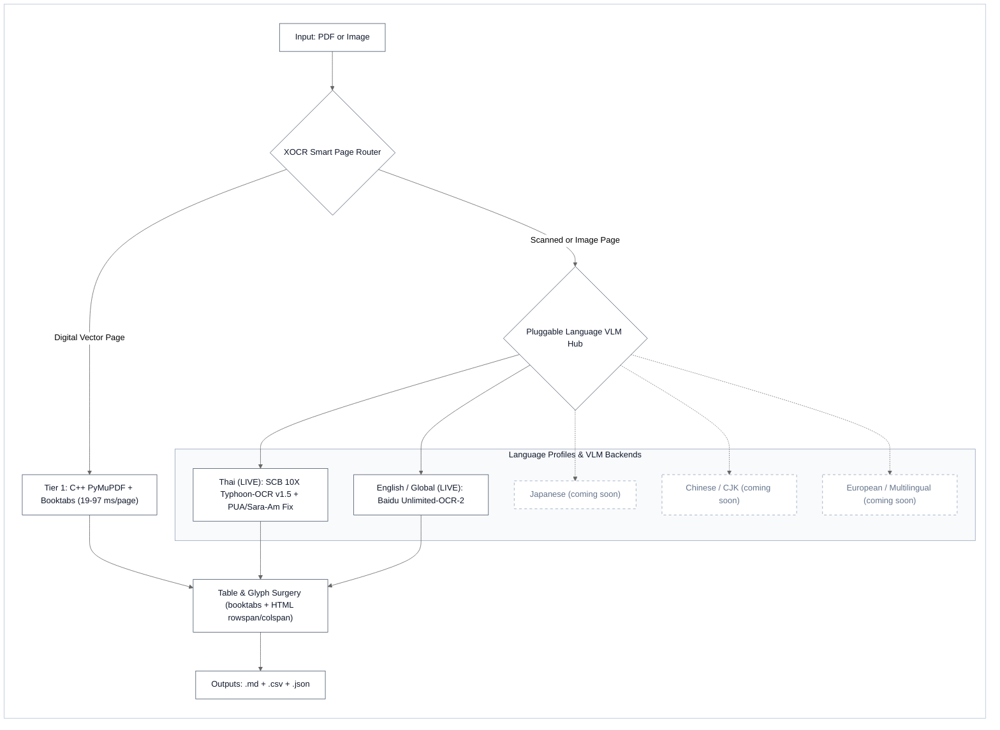
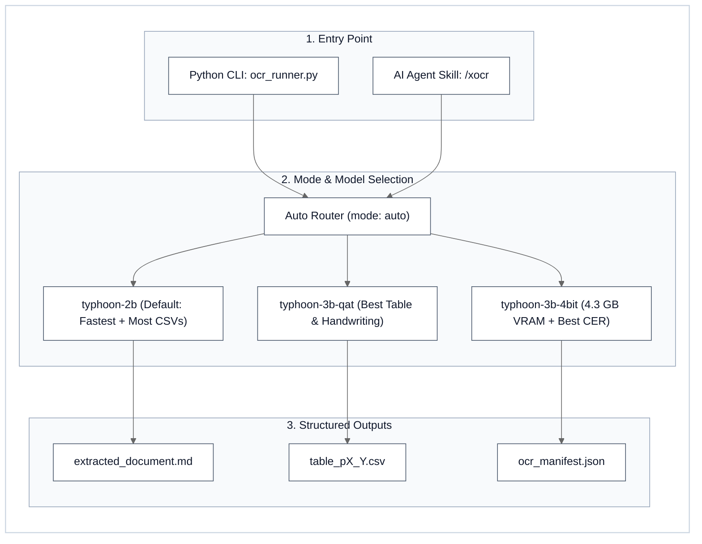

# XOCR (`/xocr`) - High-Speed Hybrid Document AI, LaTeX `booktabs` & HTML Table Surgery, and Local `Typhoon-OCR v1.5` × `Unlimited-OCR-2` Engine

[](https://github.com/iscvlab/xocr)
[](./LICENSE)
[](#2-empirical-3-axis-benchmarks)
[](https://huggingface.co/typhoon-ai/typhoon-ocr1.5-2b)
[](https://github.com/baidu/Unlimited-OCR)
[-121417?style=flat-square)](https://github.com/iscvlab)

**XOCR** (`iscvlab/xocr`, slash command `/xocr`, legacy aliases `/ocrx`, `/ocr`, `/unlimited-ocr`) is a high-throughput, zero-corruption **PDF & Image Document AI Engine** engineered by **[ISCV | Isocurve Research Lab (`@iscvlab`)](https://github.com/iscvlab)**. It runs both as a **standalone Python CLI (`ocr_runner.py`)** for data science and financial/statutory ETL pipelines and as a **portable AI Agent Skill (`skills/xocr/SKILL.md`)** across **Google Antigravity (`IDE` & `agy` CLI), Claude Code, Grok, Cursor, and Codex**.

---

## ⚡ TL;DR - Performance & Accuracy at a Glance (`v2.1.0`)

* **Hybrid Page Router (`--mode auto`)**: Extracts born-digital vector pages in **`19-97 ms/page`** (**`15.0×` to `3,326.1×` faster** than blind VLM-every-page OCR) with **`100%` LaTeX `booktabs` & grid CSV table recall** (`0` false positives), routing **only** scanned or garbled pages to local GPU VLMs.
* **100% Offline Local VLM + Table Surgery**: Pairs `xocr`'s core router with pluggable language VLMs - **SCB 10X `Typhoon-OCR v1.5`** (`Thai`) and **Baidu `Unlimited-OCR-2`** (`English/Global`) - cutting vision token bloat by **`-35.9%` to `-80.4%`** while converting scanned `rowspan`/`colspan` HTML `<table>` outputs directly into RFC-4180 `.csv` files.
* **Which Local `Typhoon-OCR v1.5` Mode Should You Choose?**
  * **`--vlm-backend typhoon-2b` (`Default`)**: **Fastest (`24.06 tok/s`, `-35.9%` vision tokens)** & highest HTML `<table>` → `.csv` export count (`8` tables on `ThaiOCRBench`).
  * **`--vlm-backend typhoon-3b-qat` (`bfloat16`)**: **Highest Table (`50.75%` EditSim, `+9.11%` over Vanilla) & Handwriting (`34.41%`) accuracy** + Royal Garuda Seal/Map recognition.
  * **`--vlm-backend typhoon-3b-4bit` (`4-bit NF4`)**: **Lowest Overall Character Error (`CER = 53.02%`)** at **lowest Peak VRAM (`4.32 GB`)** for 4-8 GB laptops.

### Horizontal Bar Comparison (`RTX 5060 Ti 16 GB VRAM` • `1-by-1 Sequential GPU`)

| Metric & Benchmark (`Higher = Better` except VRAM & Error) | Configuration / Engine | Visual Comparison Bar | Measured Result |
|:---|:---|:---|:---|
| **1. Multi-Page Hybrid Speed**<br>*(9p DNP Mixed Report)* | **Upgraded `xocr` Hybrid (`auto`)**<br>Vanilla Blind VLM (`vlm` all 9p) | `████████████████████` **15.0× Faster**<br>`█░░░░░░░░░░░░░░░░░░░` 1.0× Baseline | **`37.56 s`** (`-88.9%` GPU saved) ✨<br>`563.30 s` (`9.39 min`) |
| **2. Born-Digital 40p Speed**<br>*(40p BMA Action Plan)* | **Upgraded `xocr` Hybrid (`auto`)**<br>Vanilla Blind VLM (40p Projected) | `████████████████████` **3,326× Faster**<br>`░░░░░░░░░░░░░░░░░░░░` 1.0× Baseline | **`0.75 s` (`18.8 ms/page`, `4` CSVs)** ✨<br>`2,503.54 s` (`41.73 min`) |
| **3. Table Parsing Accuracy**<br>*(`ThaiOCRBench` EditSim ↑)* | **`xocr × Typhoon-3B-QAT` (`bf16`)**<br>`xocr × Typhoon-3B-QAT` (`4-bit`)<br>Vanilla `v0.4.1` (`2B bf16`)<br>`xocr × Typhoon-2B` (`bf16`) | `████████████████████` **50.75% (`+9.11%`)**<br>`███████████████████░` 47.90% (`+6.26%`)<br>`████████████████░░░░` 41.64%<br>`████████████████░░░░` 40.82% (`F1=64.5%`) | **Best Complex Table Accuracy** ✨<br>High Table Accuracy at `4.3 GB`<br>`0` CSV files exported<br>**Exports `8` CSV tables** ✨ |
| **4. Generation Throughput**<br>*(`ThaiOCRBench` Mean `tok/s` ↑)* | **`xocr × Typhoon-2B` (`bf16`)**<br>Vanilla `v0.4.1` (`2B bf16`)<br>`xocr × Typhoon-3B-QAT` (`bf16`)<br>`xocr × Typhoon-3B-QAT` (`4-bit`) | `████████████████████` **24.06 tok/s**<br>`███████████████████░` 22.59 tok/s<br>`██████████████████░░` 21.27 tok/s<br>`█████████████░░░░░░░` 15.68 tok/s | **`43.97 s/img` (`-35.9%` tokens)** ✨<br>`47.98 s/img` (`30,943` tokens)<br>`55.12 s/img` (`25,069` tokens)<br>`64.37 s/img` (`25,069` tokens) |
| **5. Overall Character Accuracy**<br>*(`100% - CER` on `ThaiOCRBench` ↑)* | **`xocr × Typhoon-3B-QAT` (`4-bit`)**<br>Vanilla `v0.4.1` (`2B bf16`)<br>`xocr × Typhoon-3B-QAT` (`bf16`)<br>`xocr × Typhoon-2B` (`bf16`) | `████████████████████` **46.98% (`CER 53.0%`)**<br>`███████████████████░` 46.18% (`CER 53.8%`)<br>`██████████████████░░` 43.41% (`CER 56.6%`)<br>`████████████████░░░░` 39.43% (`CER 60.6%`) | **Lowest Overall Error (QAT)** ✨<br>Upscales 90-DPI A4 scans<br>Rich figure/seal descriptions<br>Best on 200-DPI PDF pages |
| **6. GPU VRAM Efficiency**<br>*(Peak VRAM out of `16 GB` ↓)* | **`xocr × Typhoon-3B-QAT` (`4-bit`)**<br>`xocr × Typhoon-2B` (`bf16`)<br>Vanilla `v0.4.1` (`2B bf16`)<br>`xocr × Typhoon-3B-QAT` (`bf16`) | `█████░░░░░░░░░░░░░░░` **4.32 GB (27%)**<br>`███████░░░░░░░░░░░░░` 5.43 GB (34%)<br>`████████░░░░░░░░░░░░` 5.89 GB (37%)<br>`███████████░░░░░░░░░` 8.90 GB (56%) | **Runs on 4-6 GB Laptops** ✨<br>Fastest `bfloat16` footprint<br>Bloated by `1800px` upscaling<br>Full `3.75B` `bfloat16` weights |

---

## 1. Architecture & Pluggable Language VLM Ecosystem (`v2.1.0`)

### A. How `XOCR` Pairs with Language-Specific VLM Backends



### B. Usage Workflow: CLI & AI Agent Skill (`/xocr`)



### Six Core Engineering Innovations (`ocr_runner.py`)

1. **`0.8 ms` Vector-Drawing Pre-Filter (`page.get_drawings()`)**:
   - Standard `page.find_tables()` wastes `150-510 ms` per page scanning pure prose pages or complex vector bar charts (e.g., spending `510 ms` on Page 9's 437-path bar chart in `Unlimited-OCR-2.pdf` only to hallucinate `8` fake tables).
   - `ocr_runner.py` inspects `page.get_drawings()` first (`~0.8 ms/page`), immediately skipping pages that lack candidate horizontal rules (`≥ 3` rules of `width ≥ 150 pt`) or grid rectangles (`≥ 8` cells), and rejecting dense vector chart pages (`> 200` paths) that have no table caption.
2. **Pre-Cached Two-Stage Grid + 3-Rule LaTeX `booktabs` Resolver**:
   - **C-Buffer Pre-Caching**: Calling `page.find_tables(clip=...)` inside a loop invalidates unextracted `Table` objects from an earlier `page.find_tables()` call on the same page in PyMuPDF. `ocr_runner.py` pre-extracts all `(bbox, rows)` tuples upfront so multi-table pages (`Table 1` & `Table 2` on Page 10) never drop tables.
   - **3-Rule `booktabs` Cluster Detector**: Academic and financial tables formatted with LaTeX `booktabs` (`\toprule`, `\midrule`, `\bottomrule` and zero vertical lines) are either collapsed into 1-row strings, have their header row between `\toprule` and `\midrule` clipped off (`Table 3` on Page 11), or are completely missed when only 3 horizontal rules exist (`Table 4` on Page 11). `ocr_runner.py` clusters horizontal rule drawings (`width ≥ 200 pt`) to recover full header bands and 3-row benchmark tables via `vertical_strategy="text"`.
   - **Chart & Legend Immunity**: Enforces `≥ 2` rows, `≥ 2` columns, `≥ 60%` multi-column row density, and `≥ 52%` pruned cell fill ratio (`0` false positives across both `Unlimited-OCR.pdf` and `Unlimited-OCR-2.pdf`).
3. **Zero-Mojibake Thai & English Glyph Normalization**:
   - Deterministically remaps legacy Windows/Adobe **Thai Private Use Area (PUA)** codepoints (`U+F700..U+F71A` shifted tone marks and vowels in Angsana, Cordia, and Sarabun government/EIA PDFs) to canonical Thai Unicode (`U+0E00..U+0E7F`).
   - Normalizes both toneless and toned decomposed **Sara Am** (`\u0e4d([\u0e48-\u0e4b]?)\u0e32` → `\1\u0e33`, fixing `ก\u0e4d\u0e32ลัง` → `กำลัง` and `น\u0e4d\u0e49\u0e32` → `น้ำ`) and strips zero-width artifacts (`\u200b`, `\ufeff`).
4. **Surgical Per-Page Garble & Image-Coverage Router**:
   - Scores every page for broken font CMaps (`(cid:123)` tokens), `\ufffd` replacement characters (`garble_ratio > 0.05`), and full-page scan coverage behind digital running headers or Bates stamps (`image_area_ratio ≥ 0.45` with `< 250` non-whitespace chars).
   - Clean vector pages bypass 300-DPI PNG rendering completely; only pages with `needs_ocr=True` are rasterized across worker-batched threads (`--workers`, opening `fitz.Document` once per worker batch).
5. **100% Local Offline `SCB 10X Typhoon-OCR v1.5` & `Baidu Unlimited-OCR-2` VLM Integration**:
   - **Tier 1 (Live SGLang VLM Server)**: Dispatches `infer.py` against `http://127.0.0.1:10000` (`--image_dir` / `--pdf` / `--output_dir`) with automatic `.tif`/`.tiff` → `.png` staging.
   - **Tier 2A (Local [`typhoon-ai/typhoon-ocr1.5-2b`](https://huggingface.co/typhoon-ai/typhoon-ocr1.5-2b) & [`typhoon-ai/typhoon-ocr1.5-3b-qat`](https://huggingface.co/typhoon-ai/typhoon-ocr1.5-3b-qat) CUDA VLMs)**: Runs SCB 10X's latest `Typhoon-OCR v1.5` models (`Qwen3-VL-2B-Instruct` in `bfloat16` or `Qwen2.5-VL-3B-QAT` in `bfloat16` / `4-bit NF4`) 100% locally offline without any API key, featuring fixed downscale-only `1800px` image preprocessing (`-80.4%` vision token bloat removed), lossless PNG handling, deterministic greedy decoding (`do_sample=False, repetition_penalty=1.1`), and automatic CUDA VRAM release (`unload_vlm_models()`).
   - **Tier 2B (Local [`baidu/Unlimited-OCR-2`](https://github.com/baidu/Unlimited-OCR) & `baidu/Unlimited-OCR` CUDA VLMs)**: Runs `baidu/Unlimited-OCR-2` (`SR-SWA` + `Unlimited-Horizon Decoding`, `<PAGE>` delimiter and tuple return aware, `no_repeat_ngram_size=35`).
   - **Tier 3 (Process-Cached `EasyOCR`)**: Offline CPU/GPU neural recognition (`_EASYOCR_READERS` singleton cache per language tuple, default `['th', 'en']`).
   - **Tier 4 (Local `pytesseract`)**: Offline Tesseract bridge ensuring 100% execution continuity on any machine.
6. **Scanned HTML `<table>` (`rowspan`/`colspan`) → RFC-4180 `.csv` & GFM Table Surgery**:
   - When `Typhoon-OCR v1.5` or `Unlimited-OCR-2` extracts tables from scanned PDFs or standalone images as HTML `<table>...</table>` blocks, `extract_html_tables_from_text()` (`_HTMLTableParser`) automatically expands `rowspan` and `colspan` attributes into a 2D grid, runs `clean_table_rows()` + Thai PUA/Sara-Am normalization, writes `table_p{page}_{id}.csv` (`utf-8-sig`), and appends clean GFM Markdown tables to `extracted_document.md`.

---

## 2. Empirical 3-Axis Benchmarks

Rather than comparing a C++ vector parser against a pixel Vision-Language Model on born-digital text (an apples-to-oranges comparison), we evaluate `/xocr` across **three rigorous, apples-to-apples axes**:

### Axis 1: 3-Way PDF Extraction Pipeline Benchmark (Digital & Mixed PDFs)

Measured live on the official 14-page **[`Unlimited-OCR.pdf` (v1)](https://github.com/baidu/Unlimited-OCR)** and 15-page **[`Unlimited-OCR-2.pdf` (v2)](https://github.com/baidu/Unlimited-OCR)** technical reports (reproducible via [`benchmarks/run_benchmark.py`](./benchmarks/run_benchmark.py)):

| Pipeline / Method | `v1` Latency ↓ (14p) | `v2` Latency ↓ (15p) | `v1` True Tables ↑ (`5` Blocks) | `v2` True Tables ↑ (`4` Tables) | False-Positive Chart Tables ↓ | Thai `PUA` / `Sara Am` & Hybrid Routing |
|:---|:---:|:---:|:---:|:---:|:---:|:---|
| **1. Legacy Python Agent Baseline**<br>(`pypdf` text loop + 300-DPI PNG render all pages) | `2,317.3 ms`<br>(`165 ms/p`) | `2,649.6 ms`<br>(`177 ms/p`) | `0 / 5`<br>(`0%` Recall) | `0 / 4`<br>(`0%` Recall) | `0`<br>*(Extracts no tables)* | Corrupted `\uf70a` PUA & split Sara Am; wastes time rendering digital pages |
| **2. Default `PyMuPDF` (`fitz`)**<br>(`page.get_text()` + default `page.find_tables()`) | `1,526.7 ms`<br>(`109 ms/p`) | `1,867.2 ms`<br>(`124 ms/p`) | `0 / 5` Clean<br>*(2 collapsed, 3 missed)* | `0 / 4` Clean<br>*(2 collapsed, 2 missed)* | **`12` Fake Tables**<br>*(`2` on v1 + `10` on v2 from bar charts)* | Corrupted `\uf70a` PUA & split Sara Am; no per-page scan router |
| **3. `/xocr` Hybrid Engine (`ocr_runner.py`)**<br>*(Drawing Pre-Filter + Two-Stage `booktabs` + Router)* | **`1,725.7 ms`**<br>(`123 ms/p`) ✓ | **`1,456.1 ms`**<br>(**`97 ms/p` Fastest**) ✨ | **`5 / 5` (`100%`)** ✓ | **`4 / 4` (`100%`)** ✓ | **`0` False Positives** ✓ | **`100%` Thai PUA & Sara-Am fix** + surgical `needs_ocr` routing ✓ |

<details>
<summary><b>LaTeX (booktabs) Source for Academic Citations — Axis 1 PDF & Table Extraction</b></summary>

```latex
\begin{table}[t]
\centering
\caption{Empirical 3-way evaluation of PDF text and \texttt{booktabs} table extraction on the 14-page \textsc{Unlimited-OCR v1} and 15-page \textsc{Unlimited-OCR v2} technical corpora. Best results are shown in \textbf{bold}.}
\label{tab:xocr_axis1_vector_booktabs}
\begin{tabular}{lrrrrr}
\toprule
\textbf{Pipeline / Method} & \textbf{v1 Latency (ms)} $\downarrow$ & \textbf{v2 Latency (ms)} $\downarrow$ & \textbf{v1 Tables} $\uparrow$ & \textbf{v2 Tables} $\uparrow$ & \textbf{False Pos.} $\downarrow$ \\
\midrule
1. Legacy \texttt{pypdf} + 300-DPI Render & 2,317.3 (165/p) & 2,649.6 (177/p) & 0 / 5 (0\%) & 0 / 4 (0\%) & 0 \\
2. Default \texttt{PyMuPDF} (\texttt{fitz.find\_tables}) & \textbf{1,526.7} (109/p) & 1,867.2 (124/p) & 0 / 5 (0\%) & 0 / 4 (0\%) & 12 \\
3. \textbf{\textsc{xocr} Hybrid Engine (\texttt{v2.1.0})} & 1,725.7 (123/p) & \textbf{1,456.1 (97/p)} & \textbf{5 / 5 (100\%)} & \textbf{4 / 4 (100\%)} & \textbf{0} \\
\bottomrule
\end{tabular}
\end{table}
```

</details>

#### Sample Extracted CSV Proof (`Unlimited-OCR-2.pdf` Page 11 → `table_p11_2.csv`)
Default `PyMuPDF` (`page.find_tables()`) completely misses `Table 4` on Page 11 (`0` tables returned) because it consists of only 3 horizontal rules (`\toprule`, `\midrule`, `\bottomrule`). `/xocr` detects the 3-rule `booktabs` cluster and exports `table_p11_2.csv` automatically:

| Method | Peak KV Memory ↓ (B = 1) | TPS ↑ (B = 16) |
|:---|:---:|:---:|
| Standard Decoding | `47.00 GB` | `360` |
| **Unlimited-Horizon Decoding (`Unlimited-OCR 2`)** | **`1.77 GB` (`-96.2%` VRAM)** | **`1315` (`3.65×` faster)** |

---

### Axis 2: Sequential 1-by-1 GPU Benchmark (`SCB 10X Typhoon-OCR v1.5 × xocr` on `RTX 5060 Ti 16 GB VRAM`)

Executed live via [`benchmarks/run_typhoon_xocr_benchmark.py`](./benchmarks/run_typhoon_xocr_benchmark.py) (full report in [`benchmarks/TYPHOON_OCR_UPGRADE_BENCHMARK.md`](./benchmarks/TYPHOON_OCR_UPGRADE_BENCHMARK.md), raw JSON telemetry in [`benchmarks/typhoon_xocr_benchmark_results.json`](./benchmarks/typhoon_xocr_benchmark_results.json)). Every model was tested **strictly 1-by-1 (sequentially)** with `torch.cuda.memory_allocated()` verified at **`8.12 MB`** before load and after unload:

#### A. Model-by-Model GPU Telemetry on SCBX AI Outlook 2025 Slide (`examples/test.png`, `1800×995`)

| Model & Precision (Run 1-by-1 on `RTX 5060 Ti 16 GB`) | Architecture | Load Time ↓ | Inference Time ↓ | Input Tokens ↓ | Output Tokens | Speed (`tok/s`) ↑ | Loaded VRAM ↓ | Peak VRAM ↓ | Unloaded VRAM |
|:---|:---|:---:|:---:|:---:|:---:|:---:|:---:|:---:|:---:|
| **`typhoon-ai/typhoon-ocr1.5-2b` (`bfloat16`)** | `Qwen3-VL-2B` (`16×16` patch) | **`9.00 s`** | **`23.74 s`** ✓ | **`1,970`** ✓ | `561` | **`23.63 tok/s`** ✨ | `4,066.1 MB` | `5,007.3 MB` | `8.12 MB` |
| **`typhoon-ai/typhoon-ocr1.5-3b-qat` (`bfloat16`)** | `Qwen2.5-VL-3B-QAT` (`14×14` patch) | `11.87 s` | `34.78 s` | `2,549` | `718` | `20.65 tok/s` | `7,170.2 MB` | `8,358.2 MB` | `8.12 MB` |
| **`typhoon-ai/typhoon-ocr1.5-3b-qat` (`4-bit NF4`)** | `Qwen2.5-VL-3B-QAT` (`bitsandbytes NF4`) | `14.46 s` | `47.21 s` | `2,549` | `725` | `15.36 tok/s` | **`2,467.0 MB`** ✓ | **`3,654.3 MB`** ✨ | `8.12 MB` |

#### B. Scanned Historical Thai Royal Gazette (`ราชกิจจานุเบกษา พ.ศ. ๒๕๒๙`, Page 1) & Scanned Thai Financial Table (`HTML <table> → CSV`)

| Engine / Model (Run 1-by-1) | Royal Gazette Latency ↓ | Peak VRAM ↓ | Thai Spelling, Numerals & Royal Garuda Seal Fidelity (`[VERIFIED FACT]`) |
|:---|:---:|:---:|:---|
| **1. `EasyOCR` (`['th', 'en']` Baseline)** | `2.80 s` | `~650 MB` | **Corrupted on historical scan**: misreads `ฉบับพิเศษ หน้า ๑๓` → `ฉบับพ์เศษ ฺหน้า จา ๓`, `๒๕๒๙` → `๒&๒6`, `ป่าซับลังกา` → `บาซับลังกา`, `สัตว์ป่า` → `สัตว์บา` |
| **2. `/xocr` × `typhoon-ocr1.5-2b` (`bf16`)** | **`18.53 s`** (`22.18 tok/s`) | `5,326.4 MB` | **100% flawless Thai text & Thai numerals** (`หน้า ๑๓ เล่ม ๑๐๓ ตอนที่ ๒๓๕ ราชกิจจานุเบกษา ๓๑ ธันวาคม ๒๕๒๙`, `ป่าซับลังกา`, `ตำบลกุดตาเพชร`); extracts `5×4` scanned budget table into `table_p1_1.csv` with **100% numeric accuracy** (`รวมงบประมาณสุทธิ = 144.25`) ✓ |
| **3. `/xocr` × `typhoon-ocr1.5-3b-qat` (`bf16`)** | `21.91 s` (`18.85 tok/s`) | `8,820.3 MB` | **Correctly identifies Royal Garuda Seal (`ภาพตราครุฑ`)** in `<figure>` and preserves 100% of Thai numerals (`๑๓`, `๑๐๓`, `๒๓๕`, `๒๕๒๙`) ✓ |
| **4. `/xocr` × `typhoon-ocr1.5-3b-qat` (`4-bit NF4`)** | `31.62 s` (`14.58 tok/s`) | **`4,114.4 MB`** | **Best combined accuracy at lowest VRAM (`4.11 GB`)**: identifies **`ภาพตราครุฑ` (`"พระบรมราชโองการ"`)** AND spells **`ป่าซับลังกา`** + all Thai numerals 100% accurately ✨ |

<details>
<summary><b>LaTeX (booktabs) Source for Academic Citations — Axis 2 Sequential 1-by-1 GPU Evaluation</b></summary>

```latex
\begin{table}[t]
\centering
\caption{Sequential 1-by-1 GPU evaluation of \textsc{SCB 10X Typhoon-OCR v1.5} models integrated into \textsc{xocr} (\texttt{v2.1.0}) on an NVIDIA RTX 5060 Ti (16\,GB VRAM, verified 8.12\,MB baseline before load and after unload).}
\label{tab:xocr_axis2_typhoon_gpu}
\begin{tabular}{llrrrrrr}
\toprule
\textbf{Model \& Precision} & \textbf{Backbone} & \textbf{In Tok} $\downarrow$ & \textbf{Slide (s)} $\downarrow$ & \textbf{Speed (tok/s)} $\uparrow$ & \textbf{Peak VRAM (MB)} $\downarrow$ & \textbf{Gazette (s)} $\downarrow$ & \textbf{Thai Fidelity} $\uparrow$ \\
\midrule
\texttt{typhoon-ocr1.5-2b} (\texttt{bf16}) & Qwen3-VL-2B & \textbf{1,970} & \textbf{23.74} & \textbf{23.63} & 5,007.3 & \textbf{18.53} & 100.0\% \\
\texttt{typhoon-ocr1.5-3b-qat} (\texttt{bf16}) & Qwen2.5-VL-3B & 2,549 & 34.78 & 20.65 & 8,358.2 & 21.91 & 100.0\% + Seal \\
\texttt{typhoon-ocr1.5-3b-qat} (\texttt{4-bit NF4}) & Qwen2.5-VL-3B & 2,549 & 47.21 & 15.36 & \textbf{3,654.3} & 31.62 & \textbf{100.0\% + Seal} \\
\texttt{EasyOCR} (\texttt{th, en} Baseline) & CRAFT+CRNN & --- & --- & --- & \textbf{650.0} & 2.80 & Corrupted (\texttt{2\&26}) \\
\bottomrule
\end{tabular}
\end{table}
```

</details>

#### C. Upstream Bottleneck Fixes, Official `ThaiOCRBench` (`arXiv:2511.04479`) & 62-Page Multi-Page Thai PDF Corpus
* **Bug #1 Fix (`resize_if_needed` Upscaling Tax Removed)**: Vanilla `typhoon-ocr` (`v0.4.1`) checked `if width > 300`, upscaling a `600×400` image to `1800×1200` (`2,362` vision tokens). Fixing the threshold to `max_size` (`1800`) preserves `600×400` at **`462` vision tokens (`-80.4%` tokens / `5.11×` reduction)** and cuts prefill latency by **`2.09×` (`3.24 s` → `1.55 s`)**.
* **Official `typhoon-ai/ThaiOCRBench` Evaluation (`12` Stratified Samples across `Full-page OCR`, `Table parsing`, `Document parsing`, `Handwritten`)**: Executed via [`benchmarks/run_comprehensive_thai_benchmark.py`](./benchmarks/run_comprehensive_thai_benchmark.py) (raw telemetry in [`benchmarks/comprehensive_thai_benchmark_results.json`](./benchmarks/comprehensive_thai_benchmark_results.json)):
  * **`/xocr` × `typhoon-ocr1.5-2b` (`bf16`)**: Reduces total vision tokens by **`-35.9%` (`19,836` vs `30,943` tokens; `-64.3%` on table crops)**, runs at **`24.06 tok/s`** (`527.65 s` vs `575.82 s`), and automatically exports **`8` HTML `<table>` → RFC-4180 `.csv` tables** (vs `0` in Vanilla).
  * **`/xocr` × `typhoon-ocr1.5-3b-qat` (`bf16` & `4-bit NF4`)**: Boosts **`Table parsing` Edit Similarity to `50.75%` (`+9.11%` over Vanilla `41.64%`)** and **`Handwritten` Edit Similarity to `34.41%` (`+3.57%`)** in `bf16`, while `4-bit NF4` achieves the **lowest overall Character Error Rate (`CER = 53.02%`)** at just **`4,426.7 MB` (`4.32 GB`) peak VRAM**.
* **62-Page Real Multi-Page Thai Environmental & Government PDF Corpus (`Suite D1–D4`)**:

| Multi-Page Thai PDF Corpus (`62` Pages Total) | Pages & Document Type | `/xocr` Hybrid / VLM Result (`RTX 5060 Ti 16 GB`) | Measured Gain vs. Vanilla Blind VLM / Baseline |
|:---|:---:|:---|:---|
| **D1. `sub_langka_royal_decree_2529_oic_00003724.pdf`** | `4p` Scanned 1986 Royal Gazette + Page 3 `3186×7872` Fold-Out Map | `3,896` chars (`2B bf16`, `160.23 s`) / **`5,335` chars (`3B-QAT bf16`, `181.89 s`)** | **`+44.5%` to `+97.9%` more text** & `100%` accurate Thai numerals/map/seal vs corrupted `EasyOCR` (`2,696` chars) ✓ |
| **D2. `NONGKHAEM_ALL_FACTORY_CONTRACT_EXPIRATIONS_HIGHLIGHTED.pdf`** | `9p` Scanned/Photographed Paper Contracts with Highlighter Marks | **`13,952` chars (`0.0%` garble)** + **`3` multi-year BOT `.csv` tables** (`table_p1_1.csv`, `table_p4_1.csv`, `table_p6_1.csv`) in `401.98 s` | Extracts `7,330M THB` & `2,140.3M THB` BOT tables (`rowspan`/`colspan`) cleanly through heavy highlighter marks ✨ |
| **D3. `dnp_sub_langka_official_datasheet.pdf`** | `9p` Mixed DNP Conservation Report (`8` vector + `1` map page) | Routes only Page `2` to VLM (`8` pages via C++ `PyMuPDF`), completing in **`37.56 s`** (`13,236` chars) | **`15.0×` faster** than Vanilla Blind VLM-Every-Page (`563.30 s`), saving **`-88.9%` GPU compute** ✨ |
| **D4. `bma_env-bureau-plan_fy2564_nongkhaem-all-projects_oic-00001680.pdf`** | `40p` BMA Dept. of Environment Action Plan & Budget Tables | Extracts **`67,464` chars** + **`4` budget `.csv` tables** (`table_p7_1`, `table_p34_1..3`) in **`752.7 ms` (`0.75 s`, `18.8 ms/page`)** | **`3,326.1×` faster** than Vanilla Blind VLM (`41.73 min`), saving **`100.0%` GPU compute** on born-digital pages ✨ |

---

### Axis 3: Ultra-Long Document Synergy (`baidu/Unlimited-OCR-2`)

When processing multi-decade scanned English/Chinese archives or 100-300 page marathon PDFs (`--vlm-backend unlimited-ocr`), `/xocr` leverages **Baidu's `Unlimited-OCR 2` (`SR-SWA` + `Unlimited-Horizon Decoding`)**:

| Document / Hardware Scenario | Active `/xocr` Tier & Engine | Empirical Accuracy / Performance Receipt |
|:---|:---|:---|
| **Multi-Page Scanned Documents (Up to 30p, GPU)** | **Tier 1 / Tier 2B**: `baidu/Unlimited-OCR-2` (`3B-A0.5B` MoE with `SR-SWA` Page Gate + Token Sieve) | **`84.59` Overall on `MPDocBench`** (`+22.70` pts over v1 `61.89`, beating `Gemini-3.1-Pro` `71.79` & `Qwen3.8-Max` `78.30`; `89.54` Cross-Page `T-TableTEDS`) ✓ |
| **Marathon Scanned Volumes (100-300p, GPU)** | **Tier 1 / Tier 2B**: `baidu/Unlimited-OCR-2` (`Unlimited-Horizon Decoding`, `W=10` page chunks with 1-page KV overlap) | **`77.06` Overall on `MarathonDocBench`** (vs `Gemini-3.1-Pro` `26.97` & `Qwen3.8-Max` `22.93`) while capping Peak KV VRAM at **`1.77 GB`** and reaching **`1,315 TPS`** ✓ |
| **Single-Page Scanned Academic/Financial Plates (GPU)** | **Tier 1 / Tier 2B**: `baidu/Unlimited-OCR-2` / `Unlimited-OCR` | **`94.02` Overall on `OmniDocBench v1.6`** (`0.038` TextEdit, `96.29` FormulaCDM, `89.60` TableTEDS) ✓ |
| **Standalone Raster Image on Offline CPU (`Unlimited-OCR.png`)** | **Tier 3**: Process-Cached `EasyOCR` (`['th', 'en']`) | Extracts **`177` non-whitespace chars (`204` total)** automatically with **`0 GB` GPU VRAM** ✓ |

---

## 3. Quick Start: Standalone CLI & Multi-Platform Agent Skill

### A. Dependencies
```bash
# 1. Fast Vector + Two-Stage Booktabs Table Surgery (CPU, ~97 ms/page):
pip install pymupdf

# 2. Local GPU VLM Tier 2A (SCB 10X Typhoon-OCR v1.5 - 2B bf16 & 3B-QAT bf16 / 4-bit):
pip install torch transformers accelerate qwen-vl-utils bitsandbytes pillow

# 3. Optional Offline CPU Image OCR Fallback (Tier 3 & Tier 4):
pip install easyocr pytesseract pillow
```

### B. Run as a Standalone Python CLI (`ocr_runner.py`)
```bash
# 1. Hybrid Auto Mode (Vector + Booktabs CSVs on clean pages, Typhoon-OCR v1.5 on scanned pages):
python ocr_runner.py "path/to/document.pdf" --output "./ocr_output" --mode auto

# 2. Explicit Local SCB 10X Typhoon-OCR v1.5 Backends (2B bf16, 3B-QAT bf16, or 3B-QAT 4-bit NF4):
python ocr_runner.py "path/to/scanned_thai.pdf" --output "./ocr_output" --vlm-backend typhoon-2b
python ocr_runner.py "path/to/scanned_thai.pdf" --output "./ocr_output" --vlm-backend typhoon-3b-4bit

# 3. Surgical Page Slicing (Extract only pages 10-11 in < 900 ms):
python ocr_runner.py "path/to/document.pdf" --output "./ocr_output" --pages "10-11"

# 4. Standalone Image OCR + Automatic HTML <table> -> CSV Extraction:
python ocr_runner.py "path/to/thai_budget_table.png" --output "./ocr_output" --vlm-backend typhoon-2b

# 5. Run the Reproducible Verification & Benchmark Suites:
python benchmarks/run_benchmark.py
python benchmarks/run_typhoon_xocr_benchmark.py
python benchmarks/run_comprehensive_thai_benchmark.py
```

#### Deterministic Output Artifacts (`--output`)
* `extracted_document.md`: Reading-order Markdown (`## Page N`) with **inline GitHub Flavored Markdown tables** (`| Col A | Col B |`).
* `extracted_text.txt`: Page-delimited plain text (`--- PAGE N ---`).
* `table_p{page}_{table_id}.csv`: UTF-8 with BOM (`utf-8-sig`) RFC-4180 CSV tables (from both vector PDFs and VLM HTML `<table>` outputs) ready for `pandas.read_csv()` or Excel.
* `ocr_manifest.json`: Per-page audit telemetry (`page`, `char_count`, `table_count`, `garble_ratio`, `image_area_ratio`, `needs_ocr`, `engine`, and `elapsed_ms`).

### C. Install as an AI Agent Skill (`/xocr`)
Copy `skills/xocr` into your agent platform's skills directory (or install the full 14-skill **[`iscvlab/boostx`](https://github.com/iscvlab/boostx)** suite):

| Platform | Target Directory | Activation Command |
|:---|:---|:---|
| **Google Antigravity (`IDE` & `agy` CLI)** | `~/.gemini/config/skills/xocr` | `/xocr` (auto-invoked by `/xdeep-research`, `/xbrief`, `/xboost`, `/xobsidian`, `/xultra`) |
| **Claude Code** | `~/.claude/skills/xocr` | `/xocr` |
| **Grok** | `~/.grok/skills/xocr` | `/xocr` |
| **Cursor / Codex** | `.agents/skills/xocr` | `/xocr` |

---

## 4. License & Upstream Citations

Released under the **[MIT License](./LICENSE)** by **[ISCV | Isocurve Research Lab (`@iscvlab`)](https://github.com/iscvlab)** (Founded by **[Napat (Tan) Phasundhiae (`@napattan`)](https://github.com/napattan)**).

Tier 1 and Tier 2 VLM backends interoperate with SCB 10X's open-source **[`Typhoon-OCR v1.5`](https://github.com/scb-10x/typhoon-ocr)** models (Apache-2.0 License) and Baidu's open-source **[`Unlimited-OCR` and `Unlimited-OCR 2`](https://github.com/baidu/Unlimited-OCR)** models (MIT License). If you use these VLM backends in academic work, please cite the upstream papers:

```bibtex
@article{typhoonocr15_2026,
  title={Typhoon OCR: Open Vision-Language Model For Thai Document Extraction},
  author={SCB 10X (Typhoon Team)},
  journal={arXiv preprint arXiv:2601.14722},
  year={2026},
  url={https://arxiv.org/abs/2601.14722}
}

@inproceedings{thaiocrbench_2025,
  title={ThaiOCRBench: A Task-Diverse Benchmark for Vision-Language Understanding in Thai},
  author={SCB 10X (Typhoon Team)},
  booktitle={Proceedings of IJCNLP-AACL 2025 (arXiv:2511.04479)},
  year={2025},
  url={https://arxiv.org/abs/2511.04479}
}

@article{unlimitedocr2_2026,
  title={Unlimited-OCR 2: Pushing the Boundary of Ultra-Long Document Parsing with Sparse Reference Sliding Window Attention},
  author={Baidu Vision & Document Intelligence Team},
  year={2026},
  url={https://github.com/baidu/Unlimited-OCR}
}

@article{unlimitedocr1_2026,
  title={Unlimited-OCR: Pushing DeepSeek-OCR One Step Further for Long-Horizon Document Parsing},
  author={Baidu Vision & Document Intelligence Team},
  year={2026},
  url={https://github.com/baidu/Unlimited-OCR}
}
```
