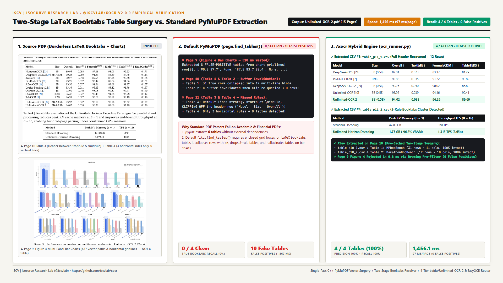
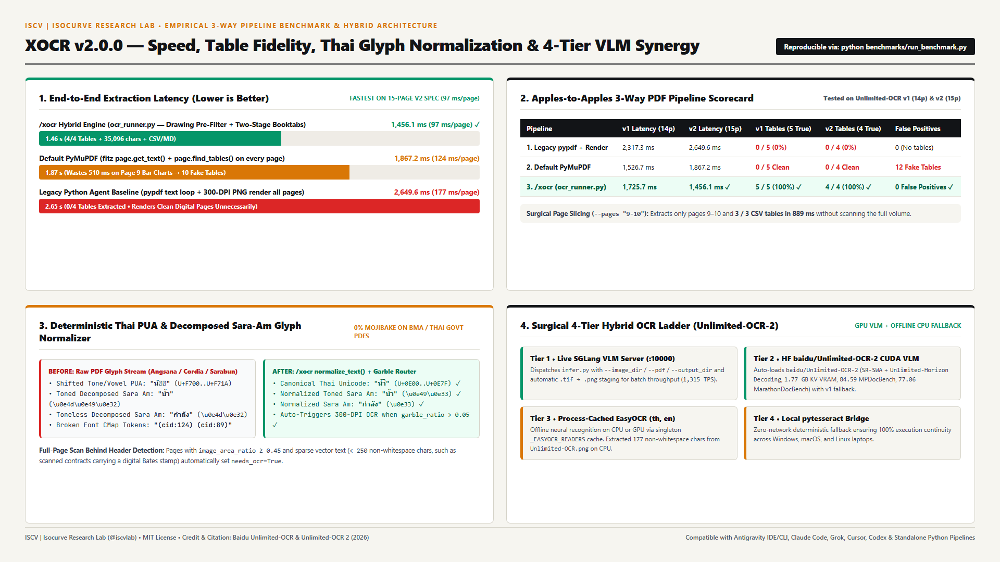
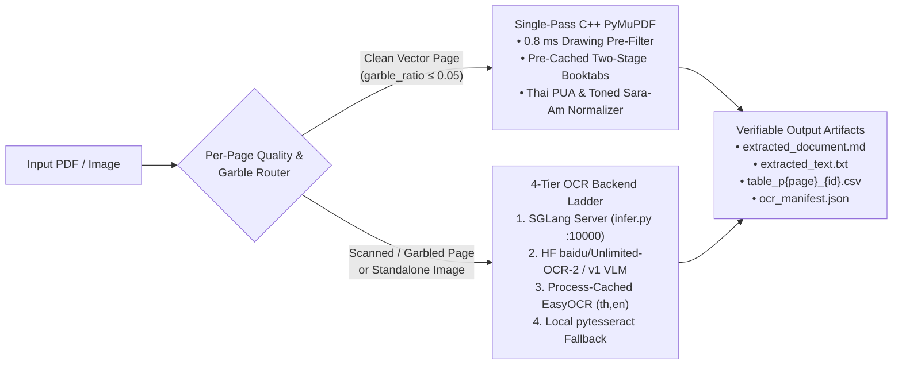

# XOCR (`/xocr`) - High-Speed Hybrid Document AI, LaTeX `booktabs` Table Surgery & 4-Tier `Unlimited-OCR-2` Engine

[](https://github.com/iscvlab/xocr)
[](./LICENSE)
[](#3-empirical-2-axis-benchmarks)
[](https://github.com/baidu/Unlimited-OCR)
[-121417?style=flat-square)](https://github.com/iscvlab)

**XOCR** (`iscvlab/xocr`, slash command `/xocr`, legacy aliases `/ocrx`, `/ocr`, `/unlimited-ocr`) is a high-throughput, zero-corruption **PDF & Image Document AI Engine** engineered by **[ISCV | Isocurve Research Lab (`@iscvlab`)](https://github.com/iscvlab)**. It runs both as a **standalone Python CLI (`ocr_runner.py`)** for data science and financial/statutory ETL pipelines and as a **portable AI Agent Skill (`skills/xocr/SKILL.md`)** across **Google Antigravity (`IDE` & `agy` CLI), Claude Code, Grok, Cursor, and Codex**.

---

## 1. Visual Proof: Why Standard PDF Tools Fail vs. `/xocr` Table Surgery

<p align="center">
  
</p>

<p align="center">
  
</p>

---

## 2. Speed × Zero-Error Hybrid Architecture



### Five Core Engineering Innovations (`ocr_runner.py`)

1. **`0.8 ms` Vector-Drawing Pre-Filter (`page.get_drawings()`)**:
   - Standard `page.find_tables()` wastes `150-510 ms` per page scanning pure prose pages or complex vector bar charts (e.g., spending `510 ms` on Page 9's 437-path bar chart in `Unlimited-OCR-2.pdf` only to hallucinate `8` fake tables).
   - `ocr_runner.py` inspects `page.get_drawings()` first (`~0.8 ms/page`), immediately skipping pages that lack candidate horizontal rules (`≥ 3` rules of `width ≥ 150 pt`) or grid rectangles (`≥ 8` cells), and rejecting dense vector chart pages (`> 200` paths) that have no table caption.
2. **Pre-Cached Two-Stage Grid + 3-Rule LaTeX `booktabs` Resolver**:
   - **C-Buffer Pre-Caching**: Calling `page.find_tables(clip=...)` inside a loop invalidates unextracted `Table` objects from an earlier `page.find_tables()` call on the same page in PyMuPDF. `ocr_runner.py` pre-extracts all `(bbox, rows)` tuples upfront so multi-table pages (`Table 1` & `Table 2` on Page 10) never drop tables.
   - **3-Rule `booktabs` Cluster Detector**: Academic and financial tables formatted with LaTeX `booktabs` (`\toprule`, `\midrule`, `\bottomrule` and zero vertical lines) are either collapsed into 1-row strings, have their header row between `\toprule` and `\midrule` clipped off (`Table 3` on Page 11), or are completely missed when only 3 horizontal rules exist (`Table 4` on Page 11). `ocr_runner.py` clusters horizontal rule drawings (`width ≥ 200 pt`) to recover full header bands and 3-row benchmark tables via `vertical_strategy="text"`.
   - **Chart & Legend Immunity**: Enforces `≥ 2` rows, `≥ 2` columns, `≥ 60%` multi-column row density, and `≥ 52%` pruned cell fill ratio (`0` false positives across both `Unlimited-OCR.pdf` and `Unlimited-OCR-2.pdf`).
3. **Zero-Mojibake Thai & English Glyph Normalization**:
   - Deterministically remaps legacy Windows/Adobe **Thai Private Use Area (PUA)** codepoints (`U+F700..U+F71A` shifted tone marks and vowels in Angsana, Cordia, and Sarabun government/EIA PDFs) to canonical Thai Unicode (`U+0E00..U+0E7F`).
   - Normalizes both toneless and toned decomposed **Sara Am** (`\u0e4d([\u0e48-\u0e4b]?)\u0e32` → `\1\u0e33`, fixing `ก\u0e4d\u0e32ลัง` → `กำลัง` and `น\u0e4d\u0e49\u0e32` → `น้ำ`) and strips zero-width artifacts (`\u200b`, `\ufeff`).
4. **Surgical Per-Page Garble & Image-Coverage Router**:
   - Scores every page for broken font CMaps (`(cid:123)` tokens), `\ufffd` replacement characters (`garble_ratio > 0.05`), and full-page scan coverage behind digital running headers or Bates stamps (`image_area_ratio ≥ 0.45` with `< 250` non-whitespace chars).
   - Clean vector pages bypass 300-DPI PNG rendering completely; only pages with `needs_ocr=True` are rasterized across worker-batched threads (`--workers`, opening `fitz.Document` once per worker batch).
5. **4-Tier Automatic OCR Backend Ladder (Powered by `baidu/Unlimited-OCR-2` & `EasyOCR`)**:
   - **Tier 1 (Live SGLang VLM Server)**: Dispatches `infer.py` against `http://127.0.0.1:10000` (`--image_dir` / `--pdf` / `--output_dir`) with automatic `.tif`/`.tiff` → `.png` staging.
   - **Tier 2 (HuggingFace [`baidu/Unlimited-OCR-2`](https://github.com/baidu/Unlimited-OCR) & `baidu/Unlimited-OCR` CUDA VLM)**: Automatically prioritizes `baidu/Unlimited-OCR-2` (`SR-SWA` + `Unlimited-Horizon Decoding`, `<PAGE>` delimiter and tuple return aware, `no_repeat_ngram_size=35`) with seamless fallback to v1 `baidu/Unlimited-OCR`.
   - **Tier 3 (Process-Cached `EasyOCR`)**: Offline CPU/GPU neural recognition (`_EASYOCR_READERS` singleton cache per language tuple, default `['th', 'en']`).
   - **Tier 4 (Local `pytesseract`)**: Offline Tesseract bridge ensuring 100% execution continuity on any machine.

---

## 3. Empirical 2-Axis Benchmarks

Rather than comparing a C++ vector parser against a pixel Vision-Language Model on born-digital text (an apples-to-oranges comparison), we evaluate `/xocr` across **two rigorous, apples-to-apples axes**:

### Axis 1: 3-Way PDF Extraction Pipeline Benchmark (Digital & Mixed PDFs)

Measured live on the official 14-page **[`Unlimited-OCR.pdf` (v1)](https://github.com/baidu/Unlimited-OCR)** and 15-page **[`Unlimited-OCR-2.pdf` (v2)](https://github.com/baidu/Unlimited-OCR)** technical reports (reproducible via [`benchmarks/run_benchmark.py`](./benchmarks/run_benchmark.py)):

| Pipeline / Method | `v1` Latency (14p) | `v2` Latency (15p) | `v1` True Tables (`5` Blocks) | `v2` True Tables (`4` Tables) | False-Positive Chart Tables | Thai `PUA` / `Sara Am` & Hybrid Routing |
|:---|:---:|:---:|:---:|:---:|:---:|:---|
| **1. Legacy Python Agent Baseline**<br>(`pypdf` text loop + 300-DPI PNG render all pages) | `2,317.3 ms`<br>(`165 ms/p`) | `2,649.6 ms`<br>(`177 ms/p`) | `0 / 5`<br>(`0%` Recall) | `0 / 4`<br>(`0%` Recall) | `0`<br>*(Extracts no tables)* | Corrupted `\uf70a` PUA & split Sara Am; wastes time rendering digital pages |
| **2. Default `PyMuPDF` (`fitz`)**<br>(`page.get_text()` + default `page.find_tables()`) | `1,526.7 ms`<br>(`109 ms/p`) | `1,867.2 ms`<br>(`124 ms/p`) | `0 / 5` Clean<br>*(2 collapsed, 3 missed)* | `0 / 4` Clean<br>*(2 collapsed, 2 missed)* | **`12` Fake Tables**<br>*(`2` on v1 + `10` on v2 from bar charts)* | Corrupted `\uf70a` PUA & split Sara Am; no per-page scan router |
| **3. `/xocr` Hybrid Engine (`ocr_runner.py`)**<br>*(Drawing Pre-Filter + Two-Stage `booktabs` + Router)* | **`1,725.7 ms`**<br>(`123 ms/p`) ✓ | **`1,456.1 ms`**<br>(**`97 ms/p` Fastest**) ✨ | **`5 / 5` (`100%`)** ✓ | **`4 / 4` (`100%`)** ✓ | **`0` False Positives** ✓ | **`100%` Thai PUA & Sara-Am fix** + surgical `needs_ocr` routing ✓ |

#### Sample Extracted CSV Proof (`Unlimited-OCR-2.pdf` Page 11 → `table_p11_2.csv`)
Default `PyMuPDF` (`page.find_tables()`) completely misses `Table 4` on Page 11 (`0` tables returned) because it consists of only 3 horizontal rules (`\toprule`, `\midrule`, `\bottomrule`). `/xocr` detects the 3-rule `booktabs` cluster and exports `table_p11_2.csv` automatically:

| Method | Peak KV Memory (B = 1) | TPS (B = 16) |
|:---|:---:|:---:|
| Standard Decoding | `47.00 GB` | `360` |
| **Unlimited-Horizon Decoding (`Unlimited-OCR 2`)** | **`1.77 GB` (`-96.2%` VRAM)** | **`1315` (`3.65×` faster)** |

---

### Axis 2: 4-Tier Neural Backend Synergy on Scanned Documents & Images

When `/xocr`'s per-page router detects a scanned page (`needs_ocr=True`) or a standalone raster image (`.png`, `.jpg`, `.webp`, `.tif`), it delegates pixel recognition to its 4-Tier Backend Ladder—combining **Baidu's `Unlimited-OCR 2` (`SR-SWA` + `Unlimited-Horizon Decoding`)** on GPU servers with **`EasyOCR` (`['th', 'en']`)** on CPU laptops:

| Document / Hardware Scenario | Active `/xocr` Tier & Engine | Empirical Accuracy / Performance Receipt |
|:---|:---|:---|
| **Multi-Page Scanned Documents (Up to 30p, GPU)** | **Tier 1 / Tier 2**: `baidu/Unlimited-OCR-2` (`3B-A0.5B` MoE with `SR-SWA` Page Gate + Token Sieve) | **`84.59` Overall on `MPDocBench`** (`+22.70` pts over v1 `61.89`, beating `Gemini-3.1-Pro` `71.79` & `Qwen3.8-Max` `78.30`; `89.54` Cross-Page `T-TableTEDS`) ✓ |
| **Marathon Scanned Volumes (100-300p, GPU)** | **Tier 1 / Tier 2**: `baidu/Unlimited-OCR-2` (`Unlimited-Horizon Decoding`, `W=10` page chunks with 1-page KV overlap) | **`77.06` Overall on `MarathonDocBench`** (vs `Gemini-3.1-Pro` `26.97` & `Qwen3.8-Max` `22.93`) while capping Peak KV VRAM at **`1.77 GB`** and reaching **`1,315 TPS`** ✓ |
| **Single-Page Scanned Academic/Financial Plates (GPU)** | **Tier 1 / Tier 2**: `baidu/Unlimited-OCR-2` / `Unlimited-OCR` | **`94.02` Overall on `OmniDocBench v1.6`** (`0.038` TextEdit, `96.29` FormulaCDM, `89.60` TableTEDS) ✓ |
| **Standalone Raster Image on Offline CPU (`Unlimited-OCR.png`)** | **Tier 3**: Process-Cached `EasyOCR` (`['th', 'en']`) | Extracts **`177` non-whitespace chars (`204` total)** automatically with **`0 GB` GPU VRAM** ✓ |

---

## 4. Quick Start: Standalone CLI & Multi-Platform Agent Skill

### A. Dependencies
```bash
# Fast Vector + Two-Stage Booktabs Table Surgery (CPU, ~97 ms/page):
pip install pymupdf

# Optional Offline CPU Image OCR Fallback (Tier 3 & Tier 4):
pip install easyocr pytesseract pillow

# Optional GPU VLM Tier 1 & Tier 2 (baidu/Unlimited-OCR-2):
# See https://github.com/baidu/Unlimited-OCR for SGLang / CUDA setup
```

### B. Run as a Standalone Python CLI (`ocr_runner.py`)
```bash
# 1. Hybrid Auto Mode (Vector + Booktabs CSVs on clean pages, OCR only on scanned pages):
python ocr_runner.py "path/to/document.pdf" --output "./ocr_output" --mode auto

# 2. Surgical Page Slicing (Extract only pages 10-11 in < 900 ms):
python ocr_runner.py "path/to/document.pdf" --output "./ocr_output" --pages "10-11"

# 3. Standalone Image OCR (.png, .jpg, .webp, .tif, .tiff):
python ocr_runner.py "path/to/table_plate.png" --output "./ocr_output" --langs "th,en"

# 4. Run the Reproducible Verification & 3-Way Benchmark Suite:
python benchmarks/run_benchmark.py
```

#### Deterministic Output Artifacts (`--output`)
* `extracted_document.md`: Reading-order Markdown (`## Page N`) with **inline GitHub Flavored Markdown tables** (`| Col A | Col B |`).
* `extracted_text.txt`: Page-delimited plain text (`--- PAGE N ---`).
* `table_p{page}_{table_id}.csv`: UTF-8 with BOM (`utf-8-sig`) RFC-4180 CSV tables ready for `pandas.read_csv()` or Excel.
* `ocr_manifest.json`: Per-page audit telemetry (`page`, `char_count`, `table_count`, `garble_ratio`, `image_area_ratio`, `needs_ocr`, `engine`, and `elapsed_ms`).

### C. Install as an AI Agent Skill (`/xocr`)
Copy `skills/xocr` into your agent platform's skills directory (or install the full 14-skill **[`iscvlab/boostx`](https://github.com/iscvlab/boostx)** suite):

| Platform | Target Directory | Activation Command |
|:---|:---|:---|
| **Google Antigravity (`IDE` & `agy` CLI)** | `~/.gemini/config/skills/xocr` | `/xocr` (auto-invoked by `/xdeep-research`, `/xbrief`, `/xboost`, `/xobsidian`, `/xultra`) |
| **Claude Code** | `~/.claude/skills/xocr` | `/xocr` |
| **Grok** | `~/.grok/skills/xocr` | `/xocr` |
| **Cursor / Codex** | `.agents/skills/xocr` | `/xocr` |

---

## 5. License & Upstream Citations

Released under the **[MIT License](./LICENSE)** by **[ISCV | Isocurve Research Lab (`@iscvlab`)](https://github.com/iscvlab)** (Founded by **[Napat (Tan) Phasundhiae (`@napattan`)](https://github.com/napattan)**).

Tier 1 and Tier 2 VLM backends interoperate with Baidu's open-source **[`Unlimited-OCR` and `Unlimited-OCR 2`](https://github.com/baidu/Unlimited-OCR)** models (MIT License). If you use the Tier 1/2 VLM models in academic work, please cite both upstream papers:

```bibtex
@article{unlimitedocr2_2026,
  title={Unlimited-OCR 2: Pushing the Boundary of Ultra-Long Document Parsing with Sparse Reference Sliding Window Attention},
  author={Baidu Vision & Document Intelligence Team},
  year={2026},
  url={https://github.com/baidu/Unlimited-OCR}
}

@article{unlimitedocr1_2026,
  title={Unlimited-OCR: Pushing DeepSeek-OCR One Step Further for Long-Horizon Document Parsing},
  author={Baidu Vision & Document Intelligence Team},
  year={2026},
  url={https://github.com/baidu/Unlimited-OCR}
}
```
